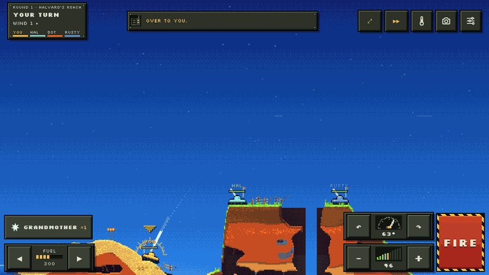
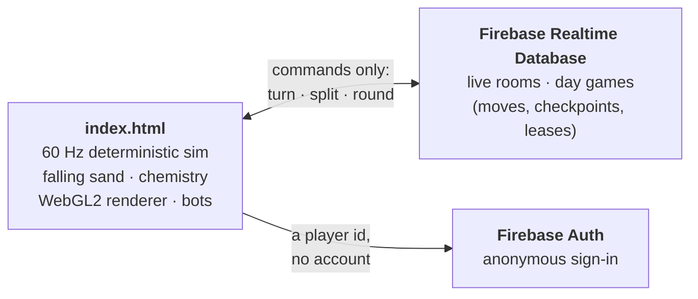

# Shellfall



[](https://shellfall-2a422.web.app)


**Pixel artillery on a world you can blow apart, flood, freeze and set on fire, one grain at a time.**

Shellfall is turn-based tank artillery in the spirit of the classics, built on a falling-sand
world. Every pixel is a grain of dirt, rock, sand, water, lava, oil, gas, ice or metal, and
everything reacts: lava meets water and turns to obsidian, acid eats straight down, a gas cloud
drifts until a spark finds it. There's one tank type; the variety is in the shells and the
chemistry.

Play solo against a cast of bot crews with grudges, run the missions, dig down an expedition to a
boss, or play friends live or over a day, a turn whenever you have a minute.

### [▶ Play now](https://shellfall-2a422.web.app)

On a phone, turn it sideways. No install, no account.

## How it works



- **The whole game is one file.** `index.html` is about 400 KB of plain JavaScript, HTML and CSS
  with no build step and no framework. The only outside code is fetched from CDNs: fonts, a QR code
  generator for invites, and the Firebase SDK once you go online.
- **The world is deterministic.** Everything that changes the world runs in a fixed 60 Hz tick
  using a seeded random number generator and only `+ - * / sqrt floor`. Even sine and cosine are
  computed in code instead of `Math.sin`, so every browser gets bit-identical results. Same
  inputs, same world, on every machine.
- **So online play only sends commands.** A turn is a handful of numbers: drive steps, angle,
  power, shell. Every player's copy replays them and ends up in exactly the same world, craters
  and all. There's no server-side game logic at all.
- **Two kinds of online play.** *Live* games are lockstep over a shared room: the host publishes
  commands, everyone else replays them in step. *Day games* are turn-based over hours or days:
  each move is stored, along with a checkpoint of the world after the latest turn, so anyone can
  open the game later, load the checkpoint, replay the moves since and take their turn.
- **No game server.** The page talks to Firebase directly. Firebase only stores and relays; the
  game runs entirely in each player's browser.
- **One explicit turn cycle.** Every turn moves through menu, aim, flight, settle, kill cam and round
  over, and each change is checked against a transition table, so an impossible jump shows up as an
  error instead of a stuck game.

The full write-up (netcode, storage layout, leases, the renderer) is in
[docs/HOW_IT_WORKS.md](docs/HOW_IT_WORKS.md).

## What's in it

**A world that reacts**
- Falling-sand simulation of 21 materials, run in 32 × 32 chunks so only the parts that move cost
  anything.
- Chemistry: lava and water make obsidian and steam, oil burns and runs downhill, gas drifts and
  ignites, gunpowder chains, acid dissolves (rock holds out longer), electricity runs through
  water and metal.
- A heat grid, a wind field, weather (rain, snow, blizzards, storms), and day, dusk and night.
- A deadly floor of lava, deep water or void: fall in and you're gone.

**Twelve shells**

| Shell | Does |
|---|---|
| Thumper | Digs a hole. Reliable. |
| Grandmother | Takes a fifth of the map with her. |
| Corkscrew | Burrows in, then heaves it all up. |
| Hot Supper | Burning oil. Runs downhill. Hates water. |
| Magma Jar | A pool of lava that keeps creeping. |
| Bilge Shot | A wave. Washes tanks off ledges. |
| Cold Shoulder | Water to ice, tanks to statues. |
| Vinegar | Eats straight down. Rock sulks but holds. |
| Stink Can | A cloud that drifts until something lights it. |
| Rattler | No crater. Loose ground lets go. |
| Sandbag | A hill of sand, on their heads. |
| Live Wire | Lethal in water. Runs along metal too. |

Any shell can be split into three mid-flight.

**Places**
- Six lands (Grasslands, Arctic, Volcanic, Swamp, Desert, Ruins), each with its own limited
  palette, layered rock, caves, mesas and arches, fossils, gem veins worth cash, and a landmark: a
  lighthouse, a windmill, a radio mast, a shrine, a stilt hut, a giant skeleton.
- Twelve hand-picked named maps, a map of the day, and endless generated ones.

**Ways to play**
- Matches against up to five bots, with a shop between rounds.
- King of the Hill, Demolition, and Expedition (a co-op descent to a boss).
- Eight training missions with star ratings.
- The Worm: something big lives underground. A bot can play it, or a friend can.
- Online with friends, live or as a day game, with a game manager to resume, leave, end or delete.

**Crews with character**
- A recurring bot cast (Rusty, Sarge, Mortimer, Dot, Hal, Brick, Nell and Gus) with fixed
  temperaments, pixel portraits and radio chatter. They hold grudges, and remember them between
  games.

**Feel**
- Kill cam with slow motion, a highlight reel, a photo mode and thermal vision.
- A ghost trail of your last shot, so you can correct your aim.
- Squash and stretch, screen shake, haptics on phones, and synthesized sound and music.

## Under the hood

| | |
|---|---|
| Code | ~6,400 lines of JavaScript in one `index.html`, plain ES2020, no framework |
| World | 1280 × 720 grains, 21 materials, simulated in 32 × 32 chunks with sleep and wake |
| Simulation | Fixed 60 Hz tick, seeded RNG, table-free trigonometry; state snapshots for kill cam and replays |
| Rendering | WebGL2 with 8 shaders: a per-land limited palette applied through a 32³ colour lookup table, luminance-stepped light with ordered dithering, emissive glow, water reflections, thermal vision. A 2D canvas fallback without WebGL2, and automatic quality scaling |
| Sound | Every effect and the theme tune are synthesized live with Web Audio; no audio files |
| Netcode | Deterministic lockstep; live games relay commands through room presence, and day games store moves plus a 50–80 KB world checkpoint |
| Online backend | Firebase Realtime Database and anonymous Auth, loaded only when online play starts; or the claude.ai Artifact platform when it runs there |
| Phones | Thumb-zone layout in landscape, a thumb-stick aim, pinch zoom, a weapon tray, full screen, and installable as a home-screen app |
| Tests | 26 Playwright browser tests: lockstep sync between browsers, day games across sessions, all missions solvable, touch controls, rendering of every land, and the real Firebase emulators for self-hosted online play. Every test also fails on an illegal turn-phase change |

### Built with

Plain JavaScript · WebGL2 · Web Audio ·
[Firebase](https://firebase.google.com/) Realtime Database and Authentication ·
[Playwright](https://playwright.dev/) for tests ·
[qrcode-generator](https://github.com/kazuhikoarase/qrcode-generator) for invite codes ·
Google Fonts: Big Shoulders Stencil, Barlow Semi Condensed, IBM Plex Mono, Silkscreen and
Special Elite

## Controls

| | Desktop | Phone |
|---|---|---|
| Aim | Drag on the field | Drag anywhere (thumb-stick) |
| Drive | `A` / `D` (`R` undoes it) | ◀ ▶ buttons |
| Change shell | `Q` / `E` | Weapon button, bottom left |
| Fire | `Space` | Fire button |
| Split a shell mid-air | `Space` again, or click | Split button (Fire, while it flies) |
| Zoom | Mouse wheel; `Z` to see the whole map | Pinch; double-tap to see it all |
| Speed up other turns | `F` | ▶▶ button |
| Thermal vision · photo · pause | `T` · `P` · `Esc` | Top-right buttons |

## Run it yourself

```bash
npm run serve
```

Then open http://localhost:8765/. Solo play, missions and expeditions work anywhere. Online play needs a backend: put your own free Firebase project's config in
`FIREBASE_CONFIG` near the top of the script in `index.html`, then deploy:

```bash
npx firebase-tools login
```

```bash
npx firebase-tools deploy --only hosting,database
```

[docs/HOSTING.md](docs/HOSTING.md) walks through setting up Firebase step by step and explains
the database rules and the free-plan limits.

## Tests

```bash
npm install
```

```bash
npx playwright install chromium
```

```bash
npm run test:quick
```

`test:quick` runs the core checks in about six minutes; `npm test` runs everything. Each test
prints what it measured; logs and screenshots land in `tests/output/`. Online play is tested
between separate browsers against stand-ins for the backend, and against the real Firebase
emulators with `npm run emulators` and `npm run test:firebase`.

## Known gaps

- Built for friends, not strangers: anyone with a game's code can join it, and a determined
  player could tamper with their own moves.
- In a day game, a player could fire, see where it lands, close the tab before it's sent and
  try again.
- Your player identity lives in your browser. Switching browser or phone makes you a new player.
- No "your turn" notifications yet.

## Who made it

Shellfall was created by **Mike Warren** ([@dinosaurmike](https://github.com/dinosaurmike)).
